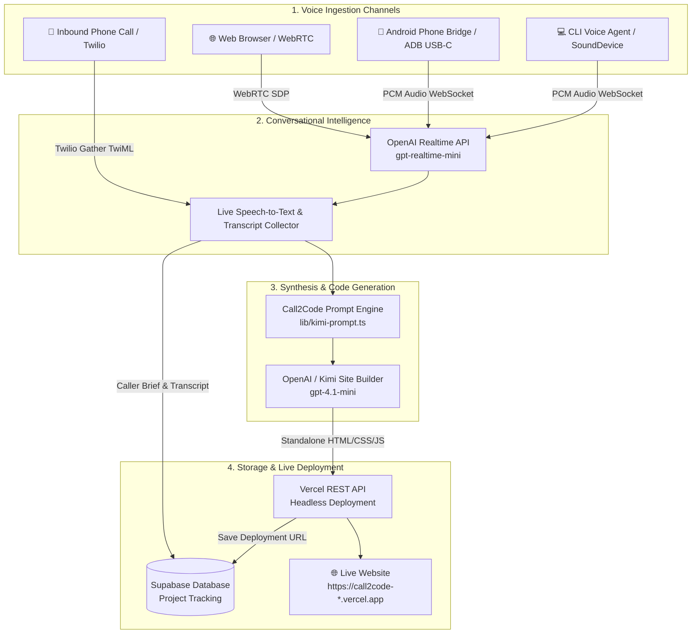

# 📞 Call2Code

> **Turn a simple phone conversation into a tailored, production-ready business website — deployed live in seconds.**

[](https://nextjs.org/)
[](https://react.dev/)
[](https://www.typescriptlang.org/)
[](https://platform.openai.com/)
[](https://vercel.com/)
[](https://supabase.com/)
[](https://developer.android.com/)
[](https://python.org/)

---

## 🌟 Overview

**Call2Code** (also presented as *Nexus Voice*) is an AI-powered voice-to-website platform designed for small business owners, freelancers, and entrepreneurs. Instead of wrestling with complex website builders, dragging and dropping blocks, or writing briefs, users simply have a natural voice conversation.

Our AI assistant interviews the business owner over a phone call or browser microphone, learns about their business, target audience, brand style, and requirements, and automatically synthesizes the conversation into an elegant, high-converting, mobile-responsive single-page website deployed directly to **Vercel** with a shareable URL.

---

## 🚀 Key Features

- **🎙️ Multi-Channel Voice Interfaces**:
  - **Browser WebRTC**: Talk directly in your web browser with low-latency WebRTC audio streaming to OpenAI Realtime.
  - **Phone Call / Twilio Webhooks**: Inbound phone numbers that greet callers, collect business goals via speech, and build their site upon hangup.
  - **Hardware Phone Bridge (`voice_bridge.py`)**: Connects an Android phone (e.g. Realme 6 Pro) via USB/Bluetooth to auto-answer calls using ADB telephony monitoring, with audio streamed through PC or headset.
  - **CLI Voice Agent (`simple_voice.py`)**: Standalone cross-platform microphone-to-speaker voice assistant.
- **🧠 Intelligent Website Generation Engine**:
  - Uses advanced prompt engineering inspired by Kimi K3 & OpenAI models (`gpt-4.1-mini`).
  - Automatically crafts custom branding, value propositions, navigation, feature grids with inline SVG icons, testimonials, and interactive contact forms with JavaScript validation.
  - Produces standalone, self-contained HTML/CSS/JS without external bundle dependencies.
- **⚡ Instant Headless Vercel Deployment**:
  - Direct integration with Vercel REST API v13.
  - Zero-config deployment targeting production within seconds.
- **📊 Realtime State & Database Persistence**:
  - Backed by Supabase PostgreSQL for storing project status, transcripts, phone numbers, and live deployment links.
  - Fallback in-memory store for zero-config local prototyping.
- **📱 Native Android Companion App**:
  - Android application built with Kotlin, Jetpack Compose, and Material 3 located in `call2code-android/`.
- **✨ Interactive Showcase Landing Page**:
  - Dark-mode promotional landing page located in `presentation/`.

---

## 🏗️ Architecture & Workflow



---

## 📂 Project Structure

```text
call2code/
├── app/                              # Next.js 16 App Router
│   ├── api/
│   │   ├── answer/                   # OpenAI answers & messaging endpoints
│   │   ├── projects/                 # Supabase project creation & status
│   │   │   └── [id]/generate/        # AI HTML generation & Vercel deployment
│   │   ├── realtime/session/         # OpenAI Realtime WebRTC ephemeral tokens
│   │   └── twilio/                   # Twilio voice inbound & speech gather webhooks
│   │       ├── voice/route.ts
│   │       └── gather/route.ts
│   ├── VoiceButton.tsx               # Client-side WebRTC voice chat component
│   ├── globals.css                   # Global styles & design tokens
│   ├── layout.tsx                    # Root HTML layout & fonts
│   └── page.tsx                      # Modern landing page & voice portal
├── lib/
│   ├── kimi-prompt.ts                # AI system prompts & website synthesis rules
│   ├── projects-store.ts             # In-memory project tracking store
│   ├── supabase-admin.ts             # Supabase service role client
│   └── vercel-deployer.ts            # Vercel REST API v13 deployment client
├── call2code-android/                # Native Android Companion App (Kotlin, Compose)
├── presentation/                     # Showcase landing page (Nexus Voice)
├── simple_voice.py                   # Standalone Python microphone voice assistant
├── voice_bridge.py                   # Low-latency Android phone call hardware bridge
├── start_call_bridge.bat             # Windows launcher for voice bridge
├── requirements-voice.txt            # Python dependencies (sounddevice, websockets, numpy)
├── supabase-schema.sql               # Supabase database schema
├── package.json                      # Node.js dependencies & scripts
└── .env.example                      # Environment variable template
```

---

## ⚙️ Environment Configuration

Create a `.env` file in the project root based on `.env.example`:

```bash
cp .env.example .env
```

| Variable | Description |
|---|---|
| `NEXT_PUBLIC_APP_URL` | Public URL of your deployed Call2Code app (e.g. `https://your-domain.vercel.app`) |
| `CALL2CODE_SERVER_URL` | Local API server URL for Python bridges (default: `http://localhost:3000`) |
| `OPENAI_API_KEY` | OpenAI API key with access to Realtime & Chat models |
| `OPENAI_REALTIME_MODEL` | Realtime voice model (e.g. `gpt-realtime-mini` or `gpt-realtime-2.1-mini`) |
| `OPENAI_SITE_BUILDER_MODEL` | Code generation model (default: `gpt-4.1-mini`) |
| `VERCEL_TOKEN` | Vercel Personal Access Token for headless deployments |
| `VERCEL_PROJECT_ID` | Vercel Project ID to deploy the generated websites into |
| `VERCEL_TEAM_ID` | *(Optional)* Vercel Team ID if deploying to a team account |
| `NEXT_PUBLIC_SUPABASE_URL` | Supabase project URL |
| `NEXT_PUBLIC_SUPABASE_PUBLISHABLE_KEY`| Supabase publishable/anon key |
| `SUPABASE_SERVICE_ROLE_KEY` | Supabase service role secret key |

---

## 🛠️ Quick Start Guide

### 1. Web Application (Next.js)

```bash
# 1. Install dependencies
npm install

# 2. Run local development server
npm run dev

# 3. Open in browser
# Navigate to http://localhost:3000
```

> **Note on WebRTC Microphone:** WebRTC microphone access requires a secure origin (`https://` or `http://localhost`). When testing from mobile devices, use HTTPS or an ngrok/cloudflared tunnel.

### 2. Standalone Python Voice Assistant (`simple_voice.py`)

Talk directly using your computer microphone and speaker. When you finish, press **Enter** to generate and deploy the site!

```bash
# 1. Install Python packages
pip install -r requirements-voice.txt

# 2. (Optional) List available audio devices
python simple_voice.py --list-devices

# 3. Start the voice assistant
python simple_voice.py

# Or specify microphone & speaker device IDs:
python simple_voice.py --input 1 --output 3
```

### 3. Android Telephony Bridge (`voice_bridge.py`)

Automatically monitor and answer incoming phone calls on a connected Android phone (via ADB & USB-C / Bluetooth):

```bash
# 1. Ensure phone has USB Debugging enabled (adb devices)
adb devices

# 2. Run the bridge
python voice_bridge.py
```

### 4. Native Android App (`call2code-android`)

Open `call2code-android/` in **Android Studio** or build from the command line:

```bash
cd call2code-android
./gradlew assembleDebug
```

### 5. Showcase Landing Page (`presentation`)

The static showcase site can be served with any HTTP server:

```bash
cd presentation
npx serve .
# Or open index.html directly in your web browser
```

---

## 📡 API Reference

| Endpoint | Method | Description |
|---|---|---|
| `/api/realtime/session` | `POST` | Requests ephemeral OpenAI Realtime WebRTC client secret |
| `/api/projects` | `POST` | Creates a new project with phone number and voice transcript |
| `/api/projects/[id]/generate` | `POST` | Synthesizes HTML from project transcript and deploys to Vercel |
| `/api/twilio/voice` | `POST` | Twilio incoming voice webhook; returns introductory TwiML greeting |
| `/api/twilio/gather` | `POST` | Captures caller speech, initializes project, and kicks off deployment |

---

## 👥 Contributors & Hackathon

Built with ❤️ for **DevDays Hackathon** by the **Call2Code** team:
- Repository: [Smrithi-krishna/call2code](https://github.com/Smrithi-krishna/call2code)

---

## 📄 License

This project is open-source under the [MIT License](LICENSE).
